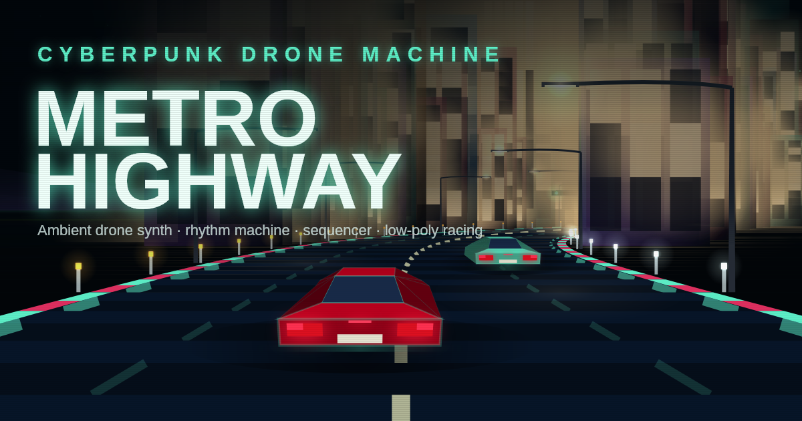

**▶ Play it here: [https://egoaid.github.io/METRO-HIGHWAY/](https://egoaid.github.io/METRO-HIGHWAY/)**

# Metro Highway

**Metro Highway** is a free, browser-based ambient drone synthesizer, rhythm
machine and step sequencer, with a low-poly cyberpunk racing game built in.
No installation, no account, no ads. After the first load it works offline,
and nothing you make is sent anywhere.

## What's inside

- **Tone / Oscillator** — waveform, envelope, filter, speaker-size control
  and LFO, with presets for pianos, organs, strings, brass, woodwinds,
  mallets, synths, guitars, lo-fi textures, drones and nature sounds. Save
  your own sounds as **User Presets**.
- **Humanize & Drift** — small random timing, velocity and pitch offsets,
  swing, and slow organic drift.
- **Lo-Fi Character** — bit crush, sample-rate reduction, jitter, clock
  drift, weak-battery saturation and noise, with a **Motion** mode that
  lets it all wander on its own.
- **Chorus** and a multi-head **Space Echo** (tape-style delay with
  wow/flutter), with per-channel sends in the mixer.
- **Rhythm Machine** — 16-step drums with built-in patterns, several kit
  voicings, polyrhythm (independent loop length per drum track) and
  auto-randomize.
- **Sequencer A** — 16-step melodic sequencer with note, velocity, gate and
  tie per step and a wide choice of scales, plus a **Slow Drone Sequencer**
  that shares the scale and plays slow background chords.
- **Keyboard** — play with mouse, touch or computer keyboard, with octave
  shift, scale snap and MIDI keyboard support where the browser allows it.
- **Auto Drone** — hands-free generative playback that randomizes
  everything and fades between songs.
- **Recording** — capture what you hear as a 16-bit stereo WAV file.
- **VFD Racing** — a low-poly, display-styled driving game that also runs
  as a tempo-synced visual when you're not playing it. Street trees that
  catch the headlights, street lamps, and the occasional traffic signal.
  The skyline, trees and mountains are holograms that glitch now and then,
  and the mountains slowly change colour.
  On a phone it plays fullscreen with a single virtual joystick, and Auto
  Drone starts along with the game.

Open **MANUAL** in the footer for a full walkthrough, in English and
Japanese. It opens as a popup and does not interrupt playback.

## Install as an app

Metro Highway is a Progressive Web App. Most browsers offer **Install** or
**Add to Home Screen** for the page; once installed it opens in its own
window and works offline.

When a newer version is published, an **update banner** appears; tap it and
the app clears its own cache and reloads. On phones the screen is kept awake
while the app is open (Screen Wake Lock, where the browser supports it).

## Browser support

Any modern browser with Web Audio support: recent Chrome, Edge, Firefox and
Safari, on desktop or mobile. Web MIDI is used automatically where
available and is optional.

## Privacy

Everything runs locally in your browser. Audio is generated on your device,
nothing is uploaded, and saved presets stay in your browser's local storage.

## Credits

© 2026 egoaid
